<div align="center">




**Un juego 2D en pixel art donde aprendes a defender tu PC de ataques de verdad.**

</div>

---

## 🌸 ¿Qué es?

DefendRush es un juego educativo de **ciberseguridad para gente normal**. No va de hackear: va de saber reaccionar cuando te llega un correo raro, salta un aviso de inicio de sesión o te aparece un ransomware en pantalla.

Todo pasa dentro de un **escritorio falso** estilo Windows retro. Tienes una sesión de PC cortita y te van llegando amenazas que tienes que parar usando las apps del sistema.

---

## 🎮 Cómo se juega

1. Empiezas en tu habitación y la cámara hace zoom al PC.
2. Durante la sesión te saltan **eventos al azar**: correos sospechosos, alertas de login, la CPU al 100 %, ventanas de rescate…
3. Respondes con las apps del escritorio. Si aciertas, sube tu puntuación y tu barra de **seguridad**. Si fallas, te la bajan.
4. Al final ves tu **resultado**: puntos, ataques bloqueados contra ataques que se te colaron, y **consejos personalizados** según tus fallos.

---

## ⚔️ Amenazas

| Amenaza | De qué va |
|---|---|
| 🎣 **Phishing** | Correos que se hacen pasar por quien no son para robarte datos |
| 🎭 **Spoofing** | Remitentes y webs falsificados |
| 🦠 **Malware** | Programas maliciosos que se cuelan en el sistema |
| 🐴 **Troyanos** | Cosas que parecen legítimas pero no lo son |
| 🔑 **Robo de contraseñas** | Contraseñas débiles o reutilizadas |
| 💀 **Ransomware** | Te cifran los archivos y te piden dinero |

## 🖥️ Apps del escritorio

**Email** · **Navegador** · **Antivirus** · **Copias de seguridad** · **Ajustes** · **Gestor de privilegios** · **Logs**

Cada amenaza tiene su minijuego: revisar un correo, pasar un escaneo, crear una contraseña segura, hacer una copia de seguridad…

---

## 🏮 Cómo está hecho

- **Motor:** Godot 4 (2D).
- **Interfaz:** toda hecha con nodos *Control* (`Panel`, `Button`, `Label`, `TextureButton` y contenedores).
- **Lógica:** escenas de Godot con scripts en GDScript que gestionan los eventos y la interfaz.
- **HUD:** barra de seguridad, temporizador de sesión y puntuación.

| Escena | Qué es |
|---|---|
| `scenes/menu.tscn` | Intro: la habitación y el zoom al PC |
| `scenes/Screen.tscn` | El escritorio simulado donde se juega |

---

## ⚡ Cómo jugarlo

1. Descarga el proyecto:
   ```bash
   git clone https://github.com/Diaz003/DefendRush.git
   ```
2. Ábrelo con **Godot 4** (*Import* → elige el `project.godot`).
3. Dale a ▶ y a jugar.

---

## 👾 Equipo

<div align="center">

| [<br>**Diaz003**](https://github.com/Diaz003) | [<br>**Dracolardex**](https://github.com/Dracolardex) | [<br>**Racara07**](https://github.com/Racara07) |
|:---:|:---:|:---:|

</div>

---

## 🎨 Créditos de assets

Los gráficos y fuentes de terceros son de sus autores, cada uno con su licencia:

- **Iconos de apps:** reffpixels — *Pixel Art App Icons*
- **GUI retro:** NullTale — *Windows XP Asset Pack*
- **GUI retro:** Comp3Interactive — *Retro Windows GUI*
- **UI cyberpunk:** *Free GUI for Cyberpunk Pixel Art*
- **Fuente:** NotJam — *Mono Clean 13*

---

## 🔒 Licencia

**Todos los derechos reservados.** El código se puede ver y el juego se puede probar, pero no copiarlo, reutilizarlo ni venderlo sin permiso del equipo. Todo el detalle está en [LICENSE](LICENSE).

<div align="center">

<sub>Hecho con 🌸 por el equipo de DefendRush</sub>

</div>
